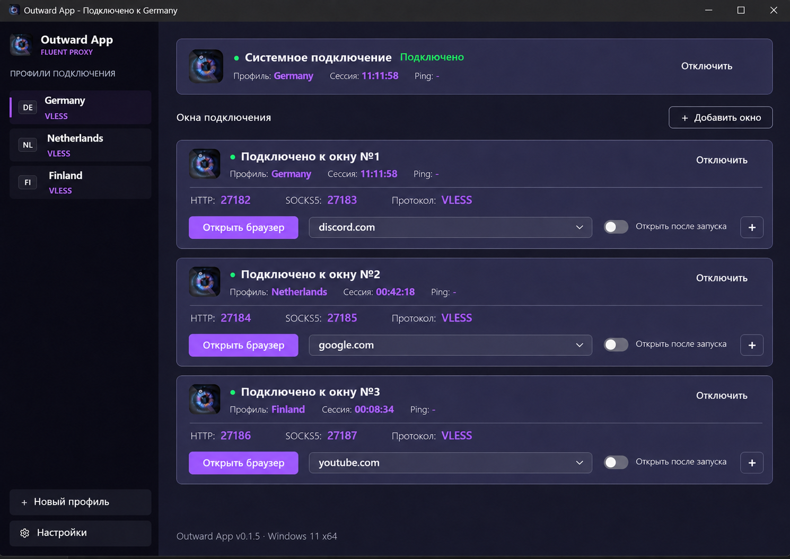

# Outward App: системный VPN и независимые окна подключений

Дата: 6 ноября 2026 года. Статус: Windows-реализация внесена в рабочую копию; приемка реального TUN и установка службы с повышением прав еще не выполнены. Результаты и оставшиеся проверки: [отчет реализации](../validation/system-vpn-and-connection-windows.md). По последнему запросу пользователя реализован также маршрут «Настройки» (P8); прежние указания об отсрочке ниже описывают первоначальный порядок этапов. Мобильные приложения остаются будущей задачей.

Документ объединяет функциональный план, согласованный эскиз главной страницы и подробные правила реализации UI/UX. Это самостоятельная спецификация для последующих задач разработки. Она не заменяет описание текущей реализации в проектном overview.

## 1. Назначение и порядок приоритетов

Пользователь должен уметь включить системный VPN, создать несколько локальных подключений с портами и использовать эти режимы отдельно или одновременно. Каждое локальное подключение представлено своим «окном» внутри главной страницы приложения.

«Окно подключения» — карточка независимой прокси-сессии, а не отдельное окно Windows и не обязательный запущенный браузер. Карточка может обслуживать другие приложения через локальные порты даже при закрытом браузере.

Обязательный приоритет: сохранить существующие возможности, визуальный стиль и удобство. Уменьшать высоту нужно за счет группировки данных и отступов, а не уменьшения шрифта, сокрытия нужных данных или удаления функций.

### 1.1. Что согласовано пользователем

- Сетевое ядро — `sing-box`.
- Один системный VPN и несколько независимых локальных подключений могут работать одновременно.
- Вверху главной страницы всегда расположен блок «Системное подключение».
- В системном блоке только состояние, профиль, время сессии, ping и управление подключением. Портов и запуска браузера в нем нет.
- Между системным блоком и списком окон справа — небольшая кнопка «Добавить окно».
- Каждое активное окно называется «Подключено к окну №N».
- Статус, параметры портов и управление браузером каждого окна объединены одной компактной карточкой.
- Кнопка браузера в карточке использует порты именно этой карточки.
- Шрифты, логотип, палитра, стиль контролов и существующие диалоги сохраняются.
- Внизу боковой панели сохраняется «+ Новый профиль», под ней в конечной навигации будет «Настройки».
- Перенос логов, настроек клиента и обновления в отдельную страницу «Настройки» выполняется ПОСЛЕ основной функциональной и UI-работы. Ее реализация не входит в текущий основной этап.
- Архитектура должна допускать отдельные приложения Android и iOS с тем же сетевым ядром и совместимыми профилями.

### 1.2. Что уточняется этим планом

Описанные ниже модели данных, поведение неактивных карточек, меню параметров, восстановление после ошибок, размеры и последовательность работ — предлагаемая техническая детализация согласованного решения. Точные размеры сверяются на реальных Qt-виджетах; эскиз не является пиксельным эталоном.

### 1.3. За рамками основной поставки

- Реализация страницы «Настройки» и переработка содержимого трех существующих вкладок.
- Выпуск Android/iOS-приложений: сейчас закладываются контракты и план проверки платформенных ограничений.
- Новые протоколы, подписки, облачная синхронизация и учетные записи.
- Публичные прокси в локальной сети: локальные порты первой версии доступны только через loopback.
- Несколько одновременно активных системных VPN внутри Outward.
- Полный kill switch при аварии сетевого процесса: отдельная дополнительная задача, см. раздел 7. Не выдавать базовое восстановление за эту защиту.

## 2. Визуальный ориентир и источник требований

Это последний эскиз, одобренный пользователем в чате. Он показывает композицию: системный блок → панель добавления → повторяющиеся компактные карточки окон. Браузерный ряд содержит ровно один переключатель «Открыть после запуска» на окно.

Изображение сгенерировано инструментом ImageGen на основе предоставленных скриншотов. Небольшие отличия текста, размеров, заливок или графики генерации не являются требованием повторить их в Qt. Логотип и реальные компоненты берутся из приложения, а не вырезаются из картинки.

При конфликте источников применять такой порядок:

1. Последние прямые указания пользователя, включая отложенную страницу настроек.
2. Зафиксированные требования этого плана и смысл согласованного эскиза.
3. Проверенные текущие исходники, `PRODUCT.md`, `DESIGN.md` и существующие UI-компоненты.
4. Общие рекомендации Impeccable, адаптированные к Windows/PySide6.

Не восстанавливать устаревший вариант диалога со скриншота поверх более новой работы в репозитории без отдельной причины. Перед реализацией заново сверить рабочее дерево: во время подготовки плана в нем уже были пользовательские изменения UI и парсера.

## 3. Текущее состояние и необходимые изменения

Таблица фиксирует исходное состояние на момент планирования. Актуальная реализация и результаты проверок описаны в отчете, ссылка в начале документа.

| Область | Проверенное текущее поведение | Что требуется |
|---|---|---|
| Подключения | Один `RuntimeState`, один `SingBoxManager`; новый запуск останавливает предыдущий | Менеджер системной сессии и коллекции окон |
| Конфигурация и журнал | Общие `config.json`, `sing-box.log` | Изолированные конфигурации и журналы сессий |
| HTTP/SOCKS5 | Одна пара портов в общих настройках | Пара портов принадлежит конкретному окну |
| Браузер | Профиль браузера привязан к номеру SOCKS-порта | Профиль привязан к стабильному ID окна; запуск использует его действующий порт |
| Проверка подключения | Запуск процесса и ожидание локальных портов | Проверка работоспособности нужного маршрута и раздельные ошибки |
| VLESS | В генераторе задано ограничение `network: tcp` | Проверить и обеспечить UDP там, где это поддерживается профилем и сервером |
| Протоколы | Парсер поддерживает VLESS, Shadowsocks, WireGuard | Проверить их в обоих режимах; не обещать новые протоколы по внешнему виду старых скриншотов |
| Права | Установщик допускает установку без администратора | Отдельная устанавливаемая привилегированная служба для TUN |
| Ядро | В `SING_BOX_VERSION` закреплена версия 1.13.14 | Не обновлять ядро неявно; конфигурации проверять закрепленной версией |

## 4. Продуктовая модель и хранение

### 4.1. Три независимые сущности

| Сущность | Содержимое | Важное правило |
|---|---|---|
| Профиль сервера | Стабильный ID, имя, страна, протокол, параметры сервера | Может использоваться системным VPN и многими окнами |
| Сохраненное подключение | ID, тип system/proxy-window, профиль, параметры запуска и портов | Существует после остановки процесса и перезапуска UI |
| Состояние сессии | Этап, поколение запуска, процесс, действующие порты, время, проверка связи, ошибка | Не считать сохраненный PID или флаг «включено» доказательством работы |

Для окна сохранять: стабильный ID, постоянный отображаемый номер, профиль, режим назначения портов, HTTP/SOCKS5-порты, выбранный URL, переключатель открытия браузера после подключения и намерение автоподключения. Предпочитаемый браузер и отключение расширений могут оставаться общими настройками клиента.

Номера окон не перенумеровываются при удалении соседней карточки. Новому окну присваивается следующий номер; ID и браузерный каталог от отображаемого номера не зависят. Порядок списка стабилен, новое окно добавляется в конец.

Системное подключение хранит отдельный выбранный профиль и свое намерение автоподключения. Полей URL и портов в его пользовательской модели нет. При необходимости технический контрольный listener не показывается как пользовательский порт.

### 4.2. Совместимость и миграция

- Ввести версию схемы сохраненных подключений и явную идемпотентную миграцию.
- Сохранить существующие ID профилей, имена, ссылки, страны, DNS, настройки браузера, список ресурсов и поведение трея.
- Создать первоначальное «Окно №1» из прежней пары портов, выбранного профиля, URL и автоподключения. Не включать системный VPN автоматически вместо прежнего локального прокси.
- Старое глобальное автоподключение перенести на это первое окно, сохранив пользовательский смысл настройки.
- Общий каталог ресурсов запуска сохранить; выбранный ресурс и автоматическое открытие сделать индивидуальными для каждого окна. Новые окна получают текущие значения по умолчанию, после чего могут менять их независимо.
- Изменение глобальных портов в старой форме не должно переназначать все существующие окна. На переходный период связать эту форму с первоначальным окном и явно подписать область применения, сохранив оформление.
- Сначала сохранить резервную копию исходных данных; записывать новые данные атомарно. При ошибке миграции не повреждать старые файлы и не запускать соединения с частично перенесенными настройками.
- Развести сохраненное намерение запуска и факт работы. После сбоя сверять процессы и состояние службы, а не просто восстанавливать зеленую карточку из JSON.
- Одновременные завершения разных workers не должны перезаписывать изменения друг друга: запись профилей, окон и реестра процессов выполняет один владелец с сериализацией.

## 5. Архитектура управления сессиями

### 5.1. Разделение ответственности

| Компонент | Ответственность |
|---|---|
| Менеджер подключений | Сохраненные system/window-объекты, команды, состояния, события для UI |
| Менеджер локальной сессии | Отдельный процесс `sing-box`, конфигурация, порты, журнал, остановка только своего процесса |
| Контроллер Windows VPN | Связь со службой, запросы запуска/остановки, получение фактического состояния |
| Координатор сети | Реальный внешний интерфейс, смена сети, согласование TUN, DNS и обхода туннеля ядрами |
| Контроллер браузера | Запуск браузера конкретного окна с его проверенными действующими портами |
| Проверка связи и диагностика | Проверки маршрута, классификация ошибок, маскирование секретов |

На Windows первая реализация использует отдельный процесс `sing-box` на каждое окно и отдельный процесс для системного TUN. Остановка/перезапуск окна не перезапускает остальные процессы. Дополнительную стоимость по памяти измерить на приемке.

Общие модели и команды не должны содержать обязательные Windows PID, пути `.exe`, Qt-виджеты или PowerShell-команды. Эти поля принадлежат платформенному адаптеру. Не переписывать приложение на другой язык ради будущих телефонов.

### 5.2. Команды и конкурентность

- Каждая команда содержит ID подключения; каждое событие — ID и поколение запуска.
- Для одной сессии операции запуска, остановки, изменения профиля и портов сериализуются. Повторный клик не создает дубль процесса.
- Разные локальные окна могут подключаться независимо. Операции с общей сетью и TUN координируются отдельно.
- Поздний ответ отмененного запуска не переводит уже остановленное окно в «Подключено».
- UI блокирует только действия, несовместимые с текущей операцией конкретной карточки. Остальные карточки и список профилей остаются доступными.
- Удаление карточки во время запуска сначала отменяет запуск и дожидается очистки; процесс не должен остаться без владельца.
- Рабочие операции выполняются вне GUI-потока. Создание и изменение Qt-виджетов — только в GUI-потоке через сигналы.

### 5.3. Файлы и владение процессами

- У каждого окна отдельный runtime-каталог под `%LOCALAPPDATA%\OutwardApp`, конфигурация, текущий и предыдущий журнал. Каталоги по стабильному ID, а не только по порту.
- Артефакты привилегированной службы и ее ядра — в защищенных системных каталогах. Служба не запускает исполняемые файлы из пользовательского writable-каталога.
- Реестр процессов хранит ID сессии, PID, время создания, фактический executable и путь конфигурации. Перед остановкой все признаки сверяются.
- Прежнюю глобальную очистку «всех старых сеансов Outward» заменить адресной сверкой и уборкой подтвержденных осиротевших сессий. Не останавливать живые окна, другую работающую копию приложения или чужой `sing-box`.
- Предусмотреть одного владельца коллекции окон на пользователя; повторный запуск приложения активирует существующий UI либо обнаруживает владельца. Машинная служба допускает только один системный VPN Outward и сообщает конфликт между пользовательскими сеансами.

## 6. Локальные порты и браузеры

### 6.1. Порты

- Базовая карточка содержит оба listener: HTTP и SOCKS5, как текущее приложение. Браузер использует SOCKS5.
- Разные окна не могут занимать один и тот же endpoint. Внутри окна HTTP и SOCKS5 различаются.
- Проверять диапазон портов, конфликт между создаваемыми окнами и занятость в ОС. Резервирование внутри менеджера защищает от двух одновременных запусков; фактическая ошибка bind остается окончательной проверкой гонки с внешним процессом.
- Автоматический режим предлагает свободную пару, сохраняет ее и повторно использует при следующих запусках. Если автоматический порт приходится заменить, показать новые значения до запуска браузера и записать причину в журнал.
- Закрепленные вручную порты без разрешения не заменять: показать «Порт 27185 занят» и действие «Изменить порты».
- Изменение портов работающего окна требует перезапуска только этого окна. Перед применением предупредить, что внешним приложениям потребуется новый адрес прокси.
- Первое окно после миграции наследует реальные настройки пользователя; пример 27182/27183 не является обязательной заменой его значений.

### 6.2. Привязка браузера к окну

- Нажатие «Открыть браузер» читает ID и состояние своей карточки, а не последний выделенный профиль или глобальную пару портов.
- Запуск разрешен после подтвержденной готовности этой сессии. Для остановленной, запускаемой или ошибочной сессии кнопку отключить, указав причину.
- Каждое окно получает отдельный каталог данных браузера по стабильному ID, чтобы уже работающий Chrome/Edge другого окна не перехватил команду с чужими proxy-настройками.
- Существующий профиль браузера первоначального окна перенести или совместимо подхватить. Не перемещать и не удалять каталог, пока его использует браузер; миграция откладывается до закрытия либо сохраняет legacy-путь для этого окна.
- При смене портов не считать существующий браузер автоматически перенастроенным: требуется его перезапуск. Не завершать сторонние процессы и не закрывать вкладки с пользовательскими данными без явного действия.
- «Открыть после запуска» относится к этому окну. Открывать один раз после успешного явного запуска или настроенного запуска приложения; не открывать новые окна при каждом автоматическом восстановлении сети.
- Сохранить выбор Chrome/Edge, список URL, диалог «Ресурсы запуска», добавление/изменение/удаление ресурсов и отключение расширений.
- Если поддерживаемый браузер отсутствует, показать сообщение в контексте окна. Не выполнять прежний незаметный fallback в обычный браузер без гарантии использования выбранного прокси.
- При остановке прокси браузер не закрывается автоматически. Не подменять proxy-режим прямым подключением; отдельно проверить DNS, WebRTC, QUIC и другое поведение браузера, выходящее за обычные HTTP(S)-запросы. Не заявлять, что один proxy-флаг изолирует любой трафик браузера.

## 7. Системный VPN, DNS и совместная маршрутизация

`sing-box` поддерживает TUN; параметры необходимо сверять с закрепленной версией 1.13.14, а не копировать новые поля из текущего сайта. См. [документацию TUN этой версии](https://github.com/SagerNet/sing-box/blob/v1.13.14/docs/configuration/inbound/tun.md).

### 7.1. Путь трафика

| Источник | Маршрут |
|---|---|
| Системные приложения без явного прокси | Системный TUN → выбранный VPN-сервер |
| Приложение, использующее порты окна №N | Локальный HTTP/SOCKS5 → сервер окна №N |
| Исходящие соединения самого ядра | Реальный внешний интерфейс → соответствующий сервер, без повторного захвата TUN |

Координатор должен определять реальный внешний интерфейс, исключая собственный TUN, и обеспечивать обход туннеля для всех сессий, включая DNS для установления связи с серверами. Возможные механизмы — автоматическое определение внешнего интерфейса и явная привязка исходящих соединений; выбор подтвердить испытанием обоих порядков запуска. См. [маршрутизацию sing-box](https://sing-box.sagernet.org/configuration/route/).

Не считать наличие двух процессов доказательством независимых маршрутов. Не создавать широкие прямые исключения для пользовательских направлений только ради обхода зацикливания.

### 7.2. Обязательные сетевые задачи

- Разделить DNS для начального разрешения адресов серверов и DNS пользовательских запросов. Установление связи не должно зависеть от еще не поднятого VPN.
- При передаче доменного имени в локальный прокси разрешать его в контексте соответствующей сессии. Самостоятельные DNS-запросы внешнего приложения могут следовать системному маршруту; эту границу не скрывать.
- Проверить Windows multi-homed DNS, блокировки DNS вне TUN и взаимодействие этих правил с независимыми прокси. Прямая привязка UDP DNS к физическому интерфейсу сама по себе может быть недостаточна.
- IPv4 и IPv6 должны идти через предусмотренный маршрут. Если профиль не обеспечивает нужную возможность, показать ограничение и исключить незаметный прямой обход; не отключать IPv6 глобально в Windows.
- Loopback сохраняется для HTTP/SOCKS5 и управления приложением. Для первой версии рекомендовать сохранение доступа к непосредственно подключенной локальной сети; ограничить исключения реальными локальными маршрутами, проверить конфликты адресов и явно описать это в диагностике.
- Проверить TCP, UDP и ограничения каждого поддерживаемого протокола. Наличие WireGuard-профиля не заменяет системный TUN автоматически: это отдельные уровни конфигурации.
- Определить MTU и подходящий TUN stack испытаниями типовых нагрузок; сначала использовать поддерживаемые значения по умолчанию, не вводить неподтвержденные «ускоряющие» настройки.
- При смене Wi-Fi/Ethernet, адреса или выходе из сна обновлять привязки и восстанавливать только затронутые сессии. В этот момент допустим разрыв активных потоков, но не неверная индикация «подключено».
- Остановка системного VPN не останавливает прокси и не возвращает их трафик в другой сервер.

### 7.3. Поведение при обрыве

При потере удаленного сервера с живым TUN переходить в восстановление и не добавлять прямой fallback пользовательского трафика. Штатное отключение VPN возвращает обычную сеть.

Аварийное исчезновение процесса или TUN может привести к возврату прямого системного маршрута. Базовая поставка должна корректно отражать потерю VPN и восстанавливать/очищать сеть, но не обещает kill switch. `strict_route` не считается доказательством защиты после смерти процесса.

Полный kill switch — отдельная дополнительная поставка: собственные правила Windows/WFP, исключения для разрешенных серверных соединений независимых окон, снятие блокировки при явном отключении, проверка падения службы и совместимости с другими сетевыми средствами. Не добавлять в UI переключатель этой функции до ее реализации и приемки.

## 8. Windows-служба и установка

- UI остается обычным пользовательским процессом; локальные окна не требуют установки службы.
- При первом включении системного VPN объяснить необходимость системного компонента и запросить установку через стандартное повышение прав Windows. Отказ оставляет локальные окна рабочими.
- Служба устанавливается в защищенный каталог, сама выбирает доверенное ядро, проверяет поддерживаемую схему запроса и формирует допустимую конфигурацию. Не принимать произвольные команды shell, executable-пути или неограниченный raw config от клиента.
- Локальный IPC-канал ограничен нужным пользователем/сеансом. Выдавать клиенту только состояние его подключений; секреты и конфигурации не попадают в общедоступные файлы или ответы диагностики.
- До установки TUN сохранить сведения о собственных изменениях сети. При частичном запуске откатить сделанные изменения, не затрагивая работающие окна.
- На перезапуске службы сверять фактическое состояние и очищать только принадлежащие ей адаптеры/правила. Не восстанавливать устаревший полный снимок сети поверх нового DHCP или ручных настроек пользователя.
- При штатной остановке сначала запросить корректное завершение ядра и уборку сети, затем применять принудительную остановку по таймауту с проверкой остаточных ресурсов.
- Обновление ядра и службы координировать: согласовать версии UI/IPC, не подменять занятый executable, не перезапускать все окна из-за смены одного профиля.
- Установщик должен поддерживать обычный proxy-only режим и установку VPN-компонента с повышением прав. Удаление/обновление службы выполняется с нужными правами и не оставляет маршруты или блокировки.

## 9. Состояния, проверка связи и журнал

### 9.1. Общая модель состояния

| Состояние | Что означает | Доступное основное действие |
|---|---|---|
| Выключено | Подключение сохранено, активной сессии нет | Подключить |
| Подготовка | Проверка профиля, портов, конфигурации/службы | Отменить |
| Подключение | Ядро запущено, ожидается готовность и проверка маршрута | Отменить |
| Подключено | Маршрут подтвержден, сессия обслуживает запросы | Отключить |
| Переподключение | Восстановление после потери сети/сервера | Отключить |
| Отключение | Завершение и освобождение ресурсов | Индикатор, повторная команда не дублируется |
| Ошибка | Запуск/работа завершились неуспешно, причина сохранена | Повторить и действие по причине |

Не смешивать здоровье удаленного сервера с наличием локального listener. Использовать несколько сигналов и ограниченное число повторов проверки: недоступность одного контрольного сайта не должна автоматически объявлять весь VPN неисправным. Контрольные запросы идут через проверяемую сессию; общая проверка интернета недостаточна.

Для системного VPN проверять именно путь через TUN: контрольный запрос средствами ОС без унаследованного HTTP/SOCKS proxy должен подтверждаться данными о маршруте и прохождением потока через системную сессию. Успех запроса через вспомогательный SOCKS-listener того же процесса сам по себе не подтверждает, что Windows направляет системный трафик в TUN.

Счетчик сессии начинается при подтвержденном подключении, использует монотонное время и сбрасывается при новом соединении. На переподключении не изображать продолжающуюся успешную сессию. Накопительную статистику отдельным новым виджетом не добавлять.

Метка `Ping: —` сохраняется. Число показывать только после реализованного измерения: в подсказке указать метод, например длительность контрольного запроса через эту сессию, а не называть HTTP-проверку ICMP-ping. Проверки ограничить по частоте и не запускать отдельный QTimer на каждую строку данных.

### 9.2. Ошибки с действием

| Краткий текст | Действие |
|---|---|
| Порт 27185 занят | Изменить порты |
| Неверные параметры профиля | Изменить профиль |
| Сервер не ответил | Повторить / Сменить профиль |
| Не удалось разрешить адрес сервера | Повторить / Подробности |
| Не установлен компонент VPN | Установить компонент |
| Недостаточно прав | Повторить установку |
| Ядро отклонило конфигурацию | Подробности |
| Поддерживаемый браузер не найден | Указать решение без прямого запуска |

Ошибка относится только к своей карточке. Не заменять ее общим модальным окном, которое блокирует работу с остальными. Если точная причина неизвестна, сообщить проверенный симптом; не писать «сервер заблокирован» только по таймауту.

Журналы разделены по сессиям, ограничены по размеру и ротируются независимо. Действия «Подробности» открывают существующий просмотр журнала с выбранным ID сессии. Для будущей страницы настроек заранее предусмотреть фильтр сессии, но не перерабатывать сейчас весь экран логов.

Маскирование ссылок, паролей, UUID/токенов и приватных ключей действует и для stderr ядра, и для журнала службы, и для текста UI. Простая передача сырых исключений пользователю недопустима.

## 10. Подробная спецификация главной страницы

### 10.1. Общая композиция и прокрутка

Главная состоит из постоянной боковой панели и рабочей области справа. В рабочей области сверху вниз:

1. Закрепленный блок «Системное подключение».
2. Невысокая строка «Окна подключения» и кнопка «+ Добавить окно» справа.
3. Прокручиваемая вертикальная коллекция карточек окон.
4. Неброский существующий footer с версией приложения и ОС.

Системный блок и строка добавления не прокручиваются вместе со списком окон. В основном режиме не создавать вложенную прокрутку внутри отдельной карточки. Колесо мыши над карточкой прокручивает список, а не случайно меняет выбранный URL.

На промежуточной стадии существующие вкладки остаются доступны без нового маршрута настроек, см. раздел 12. Финальный эскиз показывает целевую главную после последующего переноса вкладок.

### 10.2. Боковая панель и профили

- Сохранить логотип, подписи Outward App / FLUENT PROXY, текстовые страны, список и привычные операции профилей.
- Внизу сохранить «+ Новый профиль»; целевое положение «Настройки» — сразу под ней. В основном этапе не добавлять неработающую кнопку отложенной страницы.
- Выделение профиля — выбор источника для следующего действия. Само выделение не изменяет уже работающий VPN или окна.
- Системный блок и каждое окно имеют собственную привязку к профилю. Название профиля в блоке/карточке открывает контекстный выбор для этого подключения.
- Прежнее двойное нажатие, которое запускало единственный глобальный proxy, не должно случайно переключать системный VPN. Сохранить быстрый сценарий так: двойное нажатие открывает создание нового окна с этим профилем, явная кнопка «Добавить окно» завершает действие. Должно быть одинаково доступно с клавиатуры.
- Изменение профиля не перезаписывает конфигурации живых процессов молча. Каждая сессия работает с проверенным снимком профиля; изменения применяются ее явным переподключением.
- Удаление используемого профиля требует пояснения, где он используется, и явного подтверждения удаления после остановки/переназначения зависимых подключений. Не оставлять скрытые сломанные ссылки.

### 10.3. Системный блок

Ориентир: исходная компактная status-карточка высотой около 76–84 логических px при обычном масштабе. Слева текущий логотип, рядом название и состояние; под ними строка метаданных. Справа одно основное действие по состоянию.

Обязательное содержимое:

- Постоянный заголовок «Системное подключение».
- Состояние текстом и индикатором, например «Подключено» с зеленой точкой.
- «Профиль: Germany», «Сессия: 11:11:58», «Ping: —» в работающем состоянии.
- Нажимаемый профиль/«Выбрать профиль» при отсутствии выбора. В выборе явно указать «Профиль для системного подключения».
- «Подключить», «Отменить», «Отключить» или «Повторить» по таблице состояний.

Никогда не помещать сюда HTTP/SOCKS5-порты, URL, кнопку браузера, переключатель его запуска или управление ресурсами.

Системный блок виден и при работающих только локальных окнах. Он честно показывает «Выключено» и не становится зеленым из-за активности прокси. Пока профиль не выбран, вместо фиктивной сессии показывать «Выберите профиль».

### 10.4. Строка добавления окна

- Слева спокойная подпись «Окна подключения» без крупного нового заголовка.
- Справа компактная «+ Добавить окно» в существующем outline/ghost-стиле.
- Кнопка доступна независимо от состояния системного VPN и других окон.
- Диалог создания содержит выбранный профиль, предлагаемую пару портов и «Дополнительно» для ручного закрепления. Если профиль заранее выделен в библиотеке, он подставляется, но его можно сменить.
- Номер окна назначается автоматически. URL и открытие браузера по умолчанию можно унаследовать; их последующая правка не меняет другие окна.
- Основное действие «Добавить окно» сохраняет карточку и запускает ее; отмена не создает пустой сохраненный объект. Ошибка запуска остается в новой карточке для исправления и повторения.
- Если профилей еще нет, показать понятное действие «Добавить профиль» через существующий диалог. После успешного сохранения продолжить создание окна.
- Для пустого списка — короткая подсказка «Добавьте окно, чтобы получить отдельные HTTP- и SOCKS5-порты»; второй дублирующий большой CTA не нужен.

### 10.5. Единая карточка локального окна

Одна внешняя рамка и одна заливка охватывают все сведения и действия. Не возвращать отдельную status-карточку, три высокие metric-карточки и вынесенный наружу браузерный ряд.

| Область | Содержимое и поведение |
|---|---|
| Верхняя строка | Логотип, индикатор, «Подключено к окну №N», справа «Отключить» |
| Метаданные | Профиль, время сессии, ping в исходной иерархии label/value |
| Компактная строка портов | `HTTP: 27182`, `SOCKS5: 27183`, `Протокол: VLESS`; без высоких отдельных плиток |
| Браузерный ряд | «Открыть браузер», выбранный URL с dropdown, один переключатель «Открыть после запуска», кнопка «+» ресурсов |

Данные показываются именно действующей сессии. До запуска значения явно являются настроенными/ожидаемыми. При автоматическом изменении портов карточка обновляется до разрешения браузерной кнопки.

Порты допускают копирование значения/адреса через компактное действие или меню без новых больших кнопок. Полный `127.0.0.1:порт` должен быть доступен из подсказки/копирования, даже если в строке показывается только номер.

Для второстепенных операций предусмотреть небольшое меню «Параметры окна» в заголовке: смена профиля, изменение портов, автоподключение при старте, подробности/журнал, удаление. Оно не заменяет видимые основные действия. Меню доступно с клавиатуры и имеет понятное доступное имя; не полагаться только на правую кнопку мыши или hover.

Название профиля может быть нажимаемым быстрым входом в тот же выбор. Диалог всегда подписан «Профиль для окна №N». Смена работающего профиля сообщает о разрыве только этого окна; остальные подключения не трогаются.

Выключенное окно остается в списке на своем месте, сохраняет номер, порты и URL. Заголовок меняется на «Окно №N — выключено», действие — «Подключить». При ошибке заголовок «Окно №N — ошибка», под данными краткая причина и действие исправления. Надпись «Подключено к окну» показывать только в подтвержденном активном состоянии.

Удаление — отдельное действие меню, не синоним «Отключить». Для активного окна требуется подтверждение «Остановить и удалить окно №N?». Профиль сервера и общие ресурсы при этом не удаляются. Папку браузера не удалять вместе с карточкой автоматически.

### 10.6. Высота, отступы и адаптация

- Ориентир активной карточки — около 145–155 логических px при обычном окне 1100×750 и стандартном шрифте. Это цель плотности, не жесткая высота, обрезающая содержимое.
- Основной текст 13 px, заголовок состояния 16 px/700, вторичные подписи по существующей шкале 11–13 px. Не уменьшать шрифты ради количества карточек.
- Внешние отступы сверить с текущими 24–26 px рабочей области; внутри карточки около 14–16 px; между карточками 12 px. Использовать существующую шкалу 8/12/14/16 и соседние компоненты.
- Радиусы сохранить: примерно 8 px панели, 4 px обычные контролы; не превращать приложение в набор крупных pill-кнопок.
- Браузерная кнопка и маленькая «+» сохраняют удобный размер. Гибкое место в ряду — поле URL; его текст можно сократить с подсказкой, но действие и адрес должны оставаться различимыми.
- На минимальной ширине 900×560 браузерный ряд может перейти в две строки: кнопка и URL, затем переключатель и ресурсы. Метаданные и порты также могут переноситься целыми группами. Горизонтальную прокрутку главной не вводить.
- Длинные имена профилей сокращать визуально с полным доступным текстом/подсказкой; порты и основные кнопки не обрезать. Ошибка увеличивает карточку по необходимости.
- При DPI 125/150/200% и увеличенном системном тексте Qt-layout увеличивает нужную высоту. Нельзя требовать три карточки на экране ценой нечитаемости; количество видимых карточек зависит от размера окна.
- Прокрутка не прыгает при изменении таймера, ping или завершении соседней сессии. Новое окно аккуратно приводится в видимую область; переподключение не переставляет карточку в начало.

### 10.7. Браузерный ряд и ресурсы

- В ряду ровно один переключатель «Открыть после запуска». Не дублировать его отдельной синей точкой у URL и еще одним switch справа.
- Подсказка переключателя уточняет: «Открывать выбранный ресурс после подключения этого окна». Не путать с автоподключением самого окна при запуске Outward.
- Выбор сайта сохраняется в этом окне. Изменение выбора само по себе не открывает браузер.
- Кнопка «+» открывает существующий диалог «Ресурсы запуска», сохраняющий свои текущие действия и оформление. После закрытия выбор в других окнах не сбрасывается.
- Если общий выбранный ресурс удален, использующие его окна получают понятную замену из оставшихся ресурсов или пустое поле с предложением выбрать URL. Не запускать произвольный сайт молча.
- Проблема браузера отображается отдельно от состояния туннеля: «Браузер не найден» не превращает рабочий proxy в отключенный.

### 10.8. Визуальные состояния и доступность

- Состояние обозначается текстом и цветом, не только цветной точкой. Сохранить зеленый подключенный статус, фиолетовый pending, нейтральный/янтарный выключенный; ошибку выделять по существующей системе без перекраски всей карточки.
- Нормальное отключение — спокойное действие. Красный стиль предназначен для удаления/разрушительных действий, а не каждой кнопки «Отключить».
- Во время операции основной control показывает «Подключение…»/«Отключение…» и работает по таблице состояний; нет дублирования двух равнозначных кнопок для одного состояния.
- Порядок Tab: профиль/действие системы → добавить окно → действия карточек сверху вниз → остальные доступные элементы. Боковая панель также доступна по обычному порядку Qt; фокус после диалогов возвращается к инициатору.
- Для кнопок с иконкой, портов, профиля и switch задать доступные имена/описания. Кастомный switch обязан реагировать на клавиатуру и иметь видимый focus.
- Контекстное меню работает через клавиатуру; основные действия не зависят от наведения мыши.
- Проверить контраст мелких подписей на реальном Qt-рендере. Не вводить новый шрифт, иконки другого стиля, лишние графики, счетчики скорости или декоративные анимации.

## 11. Запуск, остановка и поведение жизненного цикла

### 11.1. Запуск локального окна

1. Зафиксировать снимок профиля и настроек окна; проверить поколение команды.
2. Проверить/зарезервировать порты, сформировать конфигурацию этого окна.
3. Выполнить `sing-box check` закрепленным ядром.
4. Запустить процесс и зарегистрировать подтвержденное владение.
5. Проверить listener и передачу данных по маршруту этого окна.
6. Перевести карточку в «Подключено к окну №N», показать действующие порты и время.
7. При нужном флаге один раз открыть ресурс в браузере этого окна.

Любая ошибка откатывает только ресурсы запускаемой сессии. Другие окна и системный VPN остаются в своем состоянии.

### 11.2. Запуск/остановка системы

Перед запуском проверить службу, профиль, внешний интерфейс и согласование с живыми прокси. Применять TUN и сетевые изменения контролируемой последовательностью с откатом. Готовность подтверждать проверкой именно системного маршрута.

При отключении удалить только собственные изменения TUN/DNS/маршрутов, проверить обычную сеть и работу оставшихся окон. Недоступность одной внешней контрольной цели не является поводом сбрасывать чужие настройки Windows.

### 11.3. Трей, выход, аварии и автозапуск

- Сворачивание/закрытие при включенном «Сворачивать в трей» не останавливает подключения. Явный «Выход» останавливает системную сессию и окна этого экземпляра, с ожидаемой очисткой сети.
- Обычное закрытие без режима трея соответствует явному выходу; не оставлять фоновую службу с активным VPN вопреки действию пользователя.
- При аварии UI привилегированный контроллер через ограниченную по времени проверку владельца останавливает осиротевший VPN. Локальные процессы также должны иметь механизм контроля владельца; при следующем запуске сверять и убирать подтвержденные остатки.
- При автозапуске восстановить только подключения с явным сохраненным намерением запуска. Не включать все существующие карточки автоматически.
- После сна/смены сети переподключать с ограниченными повторами и увеличением задержки. Неверная конфигурация и отказ в правах требуют исправления, а не бесконечного retry.
- Встроенный updater должен согласовать явное завершение сессий перед установкой. Отложенная переделка страницы обновления не отменяет необходимую совместимость жизненного цикла.

## 12. Страница «Настройки»: строго после основных работ

Обновление: пользователь прямо запросил этот перенос. P8 выполнен: кнопка под «+ Новый профиль», отдельная страница с тремя прежними вкладками, возврат на главную, сохранение состояний подключений/полей и выбор журнала конкретной сессии. Изначальная последовательность ниже оставлена для истории плана.

Новый маршрут и его детальную переработку в основной этап не включать. При этом существующие функции логов, настроек клиента и обновления нельзя удалить, спрятать или заменить неработающей кнопкой.

Переходный вариант реализации главной:

- Оставить существующий блок вкладок доступным ниже новой рабочей области, например в существующей нижней панели с управляемой высотой. Список окон сохраняет собственную прокрутку и ненулевую рабочую высоту.
- Не уменьшать шрифты и не переделывать содержимое трех вкладок. Если требуется изменение привязки общих полей к первому окну/значениям по умолчанию, четко подписать эту область применения.
- Подробности ошибок направлять в существующий просмотр журнала с нужной сессией.
- Переходный layout отдельно проверить на 900×560: обе области и их действия достижимы, неактивная высокая страница не раздувает всю главную. При необходимости сохранить отдельный временный доступ к тем же существующим виджетам; не выдавать временное размещение за готовую страницу настроек.

После приемки основного объема выполнить отдельный этап:

1. Перенести «Лог консоли», «Настройки клиента», «Обновление» на страницу «Настройки», сохранив внешний вид и функции их содержимого.
2. Добавить рабочую кнопку «Настройки» сразу под «+ Новый профиль» внизу боковой панели.
3. Системную карточку и окна оставить на главной; обеспечить возврат «К подключению».
4. Убрать переходное размещение вкладок с главной и повторно проверить размеры/фокус/навигацию.

Промежуточный доступ к старым функциям — требование отсутствия регрессии, а не разрешение заранее реализовывать весь отложенный раздел.

## 13. Подготовка Android и iOS

Общие для трех платформ: смысл профиля и подключения, версия схемы, команды, состояния, категории ошибок, правила маршрутизации и набор эталонных примеров конфигурации. Бинарная конфигурация `sing-box` и платформенные параметры не обязаны совпадать дословно.

| Платформа | Предлагаемая реализация |
|---|---|
| Windows сейчас | Python/PySide6, процессы `sing-box`, привилегированная служба TUN |
| Android позже | Kotlin/Compose, библиотека `sing-box`, `VpnService`, системное разрешение и уведомление |
| iOS позже | SwiftUI, библиотека `sing-box`, Packet Tunnel / Network Extension, системная конфигурация VPN |

Android допускает одну активную VPN-службу на пользователя/рабочий профиль и предоставляет защиту исходящих сокетов от повторного захвата VPN. Эти ограничения учитываются адаптером, а не переносятся в общую модель как Windows-процессы. Источник: [Android VPN](https://developer.android.com/develop/connectivity/vpn).

У официального Apple-клиента `sing-box` системная интеграция выполняется через Network Extension; доступность TUN/маршрутных возможностей отличается от Windows. Источник: [возможности Apple-клиента](https://sing-box.sagernet.org/clients/apple/features/).

До обещания мобильного паритета требуется отдельный технический прототип:

- встроенное ядро и передача системного TUN;
- foreground/background-жизненный цикл, смена сети, сон, память и батарея;
- работа нескольких listener и изменение одной логической сессии без нежелательного перезапуска остальных;
- доступность локальных портов другим приложениям, а не только самому Outward;
- возможность режима «только порты, без системного VPN», особенно на iOS;
- ограничения распространения, entitlement/подписания и условия использования ядра.

На мобильных один встроенный экземпляр может обслуживать несколько логических входов/маршрутов. Решение подтвердить прототипом; не обещать отдельный процесс на окно, неограниченное количество портов или полную Windows-изоляцию.

Мобильный UI пока остается концепцией: VPN, серверы, настройки с нативными компонентами. Windows-карточки не копируются на телефон уменьшенным масштабом; advanced-порты показываются только после подтверждения возможностей ОС. Выпуск мобильных приложений не является условием завершения Windows-этапа.

## 14. Порядок реализации и результаты этапов

Разработка начата по прямому запросу пользователя после подготовки этого плана. Windows-код этапов P0–P7 внесен в рабочую копию; завершенными сетевыми испытаниями это не считается. Данные/локальные процессы/UI проверены автоматически и отрисовкой, а реальная служба, TUN, браузеры и нагрузка требуют оставшейся приемки из отчета. P8 отложен прямым указанием пользователя.

| Этап | Работы | Условие завершения |
|---|---|---|
| P0. Зафиксировать исходное состояние | Сверить живые изменения рабочей копии, профили/настройки, нынешние UI-сценарии и протоколы; определить версии Windows и ядра для испытаний | Есть базовый набор сценариев без регрессии и перечень известных ограничений |
| P1. Данные и контракты | Разделить профиль, подключение, состояние; миграция; команды с ID/поколением; сериализация записи | Старые данные восстанавливаются, миграция повторяема, системный VPN сам не включается |
| P2. Независимые локальные сессии | Отдельные конфигурации/журналы/процессы, выделение портов, отмена/очистка, адресные команды | Два и более окна независимо запускаются, останавливаются и переживают ошибку соседа |
| P3. Браузер каждого окна | Каталоги по ID, URL/переключатель на окно, сохранение ресурсов и старого браузерного профиля | Проверено, что браузеры разных окон используют их реальные порты и не перехватывают запуск друг друга |
| P4. Служба и системный TUN | Установка, ограниченный IPC, конфигурации, запуск/откат, подтверждение маршрута | VPN отдельно запускается/останавливается; отказ в установке не ломает proxy-only режим |
| P5. Совместная сеть | Координатор внешнего интерфейса, DNS, IPv6, UDP, оба порядка старта, сон/смена сети | VPN и окна сохраняют назначенные маршруты и не создают цепочку «proxy внутри VPN» |
| P6. Главная по эскизу | Закрепленная система, строка добавления, компактные карточки, все состояния/меню/диалоги, async UX | Все требования раздела 10 выполнены на реальном Qt, старые вкладки остаются доступны |
| P7. Устойчивость и поставка | Проверки ошибок, владельцев, версии службы, updater/installer/uninstaller, нагрузка, документация | Матрица раздела 15 пройдена; поведение обрыва явно описано |
| P8. Отдельно после основной приемки | Страница «Настройки» по разделу 12 | Все три существующие вкладки перенесены без потери функций; главная соответствует чистому эскизу |

Технические исследования мобильной интеграции можно проводить после P1 отдельно от Windows-поставки. Результаты ограничений вносятся в возможности платформ, а не меняют самовольно согласованную главную Windows.

После согласования делить реализацию на небольшие задачи по этапам. В каждой задаче указывать разделы этой спецификации и проверяемый результат; не смешивать переработку страницы настроек с P1–P7.

## 15. Приемка: функционал, сеть и UI

### 15.1. Обязательные сценарии

- [ ] Только системный VPN, ни одного активного окна.
- [ ] Одно/несколько активных окон при выключенном системном VPN.
- [ ] VPN и минимум три окна на разных профилях; также один профиль одновременно в разных сессиях.
- [ ] Порядок старта «сначала VPN» и «сначала окна»; добавление окна при работающем VPN.
- [ ] Отключение/перезапуск/смена профиля одного окна не останавливают остальные процессы и не меняют их порты.
- [ ] Отключение VPN сохраняет работоспособность окон.
- [ ] Браузер каждого окна использует именно его SOCKS5-порт и каталог данных; второй запуск не уходит в браузер другого окна.
- [ ] URL, общий список ресурсов, автозапуск браузера и отключение расширений сохраняют свой смысл.
- [ ] Занятый закрепленный порт, гонка за порт, неверный профиль и отказ службы дают адресную ошибку и оставляют соседей рабочими.
- [ ] Быстрое подключение/отмена/удаление и позднее завершение worker не создают осиротевший процесс или ложный зеленый статус.
- [ ] Реальные маршруты, IPv4/IPv6, DNS, TCP/UDP проверены на поддерживаемых протоколах. Разные внешние IP использовать как дополнительный признак, не единственный: серверы могут иметь общий выход.
- [ ] Сон/выход из сна, смена Wi-Fi/Ethernet, исчезновение внешнего интерфейса, удаленного сервера, ядра, UI и службы обработаны по описанной политике.
- [ ] Остановка, обновление и удаление приложения очищают только принадлежащие Outward ресурсы и не ломают обычную сеть.
- [ ] Миграция старых данных, сохранение legacy браузерного каталога и повторный запуск не теряют пользовательские настройки.
- [ ] Старые логи, настройки клиента, обновление и диалоги остаются доступны до P8.

### 15.2. Визуальная приемка

- [ ] Проверен именно PySide6/Qt-рендер, не сгенерированный эскиз и не браузерный макет.
- [ ] Системный блок всегда сверху и без портов/браузера; зеленые окна не означают включенный системный VPN.
- [ ] Каждое окно — одна компактная рамка, порты/протокол в строке, браузерные действия внутри своей карточки.
- [ ] «Добавить окно» одна, справа между системой и списком.
- [ ] Ровно один auto-open switch на окно; он не управляет другими окнами.
- [ ] Сохранены Segoe UI, палитра, логотип, стиль кнопок/полей/диалогов и различие HTTP/SOCKS5.
- [ ] Проверены пустое состояние, выключенные окна, запуск, восстановление, ошибка и длинные имена.
- [ ] Размеры 1100×750 и 900×560, DPI 100/125/150/200%, увеличение текста не скрывают действия.
- [ ] Список из 1/3/10/30 карточек имеет устойчивую прокрутку и не заставляет главный блок уезжать вверх.
- [ ] Клавиатура, focus, screen-reader-имена и возврат из диалогов работают для основных сценариев.

### 15.3. Проверки реализации

Автоматические проверки нужны для значимых контрактов: миграция, распределение портов при конкуренции, независимая остановка, отмена и устаревшие события, классификация/маскирование ошибок, конфигурации и браузерные аргументы с ID окна. Сохранить и учитывать уже существующие тесты UI в рабочей копии.

Интеграционные испытания с настоящим TUN проводить на выделенной Windows-среде с восстановлением сети. Моки и успешный `sing-box check` не подтверждают маршрутизацию, DNS, фоновые процессы или скорость.

Измерить память, CPU, задержку и передачу данных для VPN, одного окна и совместной работы с 3/10 окнами на одинаковых серверах/условиях. Отдельно проверить отзывчивость UI с 30 карточками и потоками журналов; не устанавливать произвольный hard limit и не обещать бесконечное число процессов.

Не запускать нагрузочные сетевые испытания и не менять маршруты пользователя в рамках подготовки документа. Бюджеты производительности зафиксировать по измеренному baseline до приемки реализации.

## 16. Карта будущих изменений в репозитории

Это направления работ, а не обязательные имена всех новых файлов.

| Текущая область | Будущее изменение |
|---|---|
| `outward_app/core/models.py` | Модели system/window-подключений, состояние и совместимость |
| `outward_app/core/storage.py` | Версионирование, миграция, атомарное сохранение без гонок |
| `outward_app/core/singbox.py` | Параметризованные конфигурации и процессы; выделение из монолитного менеджера |
| `outward_app/paths.py` | Пути по ID сессии и разделение пользовательских/служебных файлов |
| Новые core/platform-компоненты | Координатор сессий, Windows VPN/IPC, наблюдение сети, диагностика |
| `outward_app/core/browser.py` | ID окна вместо глобального порта как идентичность браузерного профиля |
| `outward_app/core/connections.py` | Проверка реальных возможностей профиля без потери текущих исправлений |
| `outward_app/ui/main_window.py` | Сборка главной и привязка адресных команд вместо единственного RuntimeState |
| `outward_app/ui/widgets.py` и новые UI-компоненты | Повторно используемая карточка окна, системный блок, список; не копипастить workers на каждую карточку |
| `outward_app/ui/styles.py` | Повторное использование QSS-токенов и минимальные дополнения для новых состояний |
| `outward_app/ui/dialogs.py` | Небольшие диалоги создания/параметров окна, сохранение существующих профилей/ресурсов |
| `outward_app/core/autostart.py`, updater | Намерения запуска по сессиям и согласованное завершение перед обновлением |
| Installer/build/package | Установка/обновление/удаление службы и ядра из защищенных каталогов |
| `tests/` | Проверки контрактов, регрессии существующего поведения, интеграционные сценарии |

При реальном изменении функционала обновлять release notes, проектный overview и намеренные изменения `DESIGN.md`. Этот документ описывает будущее поведение и не должен объявлять его уже поставленным. Служебные конфигурации, журналы и кэши не коммитить; уточнить `.gitignore` при появлении новых runtime-путей.

## 17. Контроль готовности перед началом кода

- [ ] Прочитаны текущие `outward-app-start-here`, overview, `PRODUCT.md`, `DESIGN.md` и Impeccable Qt integration; существующие изменения пользователя сохранены.
- [ ] Согласован основной объем P1–P7 с отложенным P8; наличие финальной кнопки «Настройки» на эскизе не трактуется как разрешение начать ее реализацию раньше.
- [ ] Определены тестовая Windows-среда, реальные профили для проверки и закрепленная версия ядра; секреты не попадают в фикстуры/скриншоты.
- [ ] Определены версии схемы и IPC, граница службы, владельцы процессов и политика аварийного восстановления.
- [ ] Первый этап разработки ограничен своим результатом и имеет проверяемую приемку; нет скрытого расширения на мобильные приложения, новые протоколы или kill switch.

Итог основной поставки: системный VPN и независимые прокси-окна работают одновременно; каждое окно компактно и управляется само по себе; существующие возможности остаются доступными. После этого отдельной задачей выполняется страница «Настройки».
