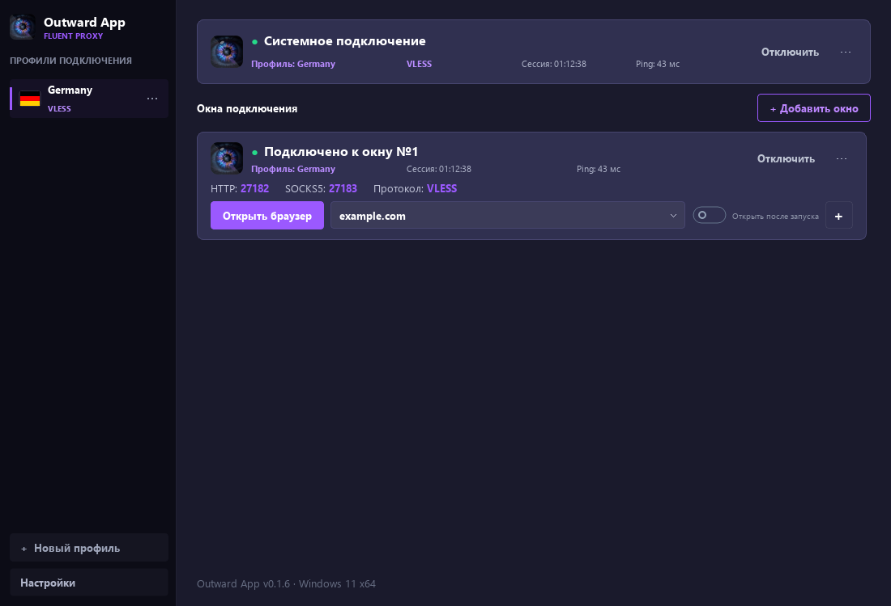
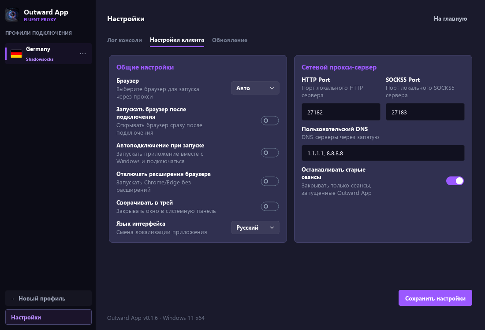

# Реализация системного VPN и окон подключений

6 ноября 2026 года. Реализация находится в рабочей копии. Релиз и установка службы на этом компьютере не выполнялись. Основная спецификация: [план](../plans/system-vpn-and-connection-windows.md).

## Что реализовано

- `SessionController` управляет системным подключением и коллекцией независимых прокси-окон. У каждого окна отдельный процесс sing-box, конфигурация, журнал, пара HTTP/SOCKS5, профиль, состояние и поколение запуска. Один серверный профиль допускается использовать в нескольких подключениях.
- Запуск, проверка сети, браузера, установка компонента и чтение системного журнала выполняются вне потока интерфейса. Поздний результат отмененного подключения не превращает его в активное. Остановка и ошибка одного окна не останавливают остальные.
- Для Windows TUN добавлен отдельный компонент `OutwardVPNService`: нативная служба SCM, ограниченный JSON IPC через локальный named pipe, доступ устанавливающему пользователю/администраторам/SYSTEM, проверка PID службы перед передачей профиля, владение сессией и heartbeat. Служба генерирует конфигурацию сама; произвольные команды, пути и конфигурации не принимает.
- Компонент устанавливается из собранного приложения через меню системной карточки. Только установка/обновление требует UAC; обычное окно Outward остается без повышения прав. Код службы и ядро копируются в защищенный каталог Program Files, конфигурация и журнал — в защищенный ProgramData. Установщик включает отдельную сборку службы; удаление приложения вызывает удаление регистрации компонента.
- Конфигурация TUN содержит IPv4/IPv6, DNS hijack, auto/strict routes и исключения локальных маршрутов. Исходящие соединения ядра и прокси-окон привязываются к физическому интерфейсу, чтобы избежать повторного попадания в TUN. Bootstrap DNS сервера отделен от DNS пользовательского трафика. Работа этих правил с реальными сетями требует приемки ниже.
- Успешный запуск процесса не считается подключением: окно проверяет HTTPS через свой HTTP-порт; служба проверяет выбранный Windows маршрут в OutwardVPN и HTTPS через системную сеть. Ping VLESS/Shadowsocks измеряет отдельное TCP-соединение до сервера без DNS/TLS/HTTP; для UDP WireGuard длительность HTTPS обозначена отдельно. Нет автоматического переключения пользовательского трафика на direct при ошибке upstream в живом TUN. Полноценный kill switch при аварии процесса в эту поставку не входит.
- При смене сети выполняется переподключение затронутых сеансов; повторные неудачные автоматические старты ограничены. Ошибки профиля/установки требуют действий пользователя. Проверки интерфейсов кешируются между окнами.
- Порты закрепляются за стабильным ID, включая остановленные окна. Автоматический режим подбирает свободные порты; фиксированный сообщает конфликт. Действующие браузерные привязки дополнительно защищаются от назначения другому окну. После изменения порта уже работающий браузер нужно закрыть и открыть снова.
- Каталог браузера привязан к ID окна; прежний каталог первого подключения используется на месте, без перемещения cookies работающего браузера. Каждая кнопка запуска берет SOCKS5-порт, URL и переключатель своей карточки. При отсутствии Chrome/Edge выводится ошибка.
- Введен версионный `connections.json`, атомарные записи, резервные копии до миграции и проверка схемы. Старые профили/настройки не удаляются. Прежнее автоподключение переносится на первое прокси-окно; системный VPN автоматически не включается вместо него.
- Процессы принадлежат конкретным менеджерам и Windows Job Objects. Штатная остановка посылает CTRL_BREAK в отдельную скрытую консоль ядра, чтобы sing-box выполнил сетевую очистку; отдельный короткий helper проверяет PID и время создания процесса. При зависании действует ограниченное по времени принудительное завершение. Нет массового завершения sing-box по имени или только пути конфигурации. Журналы ограничены по размеру, ошибки и журналы проходят маскирование секретов.

## Интерфейс

Снимок сделан с синтетическими состояниями для проверки верстки, без активного VPN и пользовательских данных.

Сверху закреплена карточка «Системное подключение»: точка состояния с подсказкой/доступным именем, серверный профиль, используемый протокол, время сессии, Ping, подключение/отключение и меню. Отдельная правая надпись «Подключено/Выключено» убрана по запросу пользователя. Порты и браузерные действия в ней отсутствуют.

Под ней строка «Окна подключения» и небольшая кнопка «+ Добавить окно» справа. Диалог позволяет выбрать сервер и автоматические либо фиксированные HTTP/SOCKS5-порты. Новое окно добавляется в конец и запускается. Номера соседних окон после удаления не меняются.

Карточка окна объединяет заголовок «Подключено к окну №N», профиль, время, Ping, отключение/меню, строку HTTP/SOCKS5/протокола, браузер, ресурс, индивидуальный переключатель открытия после запуска и управление ресурсами. Из меню доступны профиль/порты, автоподключение, журнал, копирование адресов и удаление. Активное изменение профиля/портов предлагает переподключить только эту сессию. Ошибка показана текстом на своей карточке, подробности открываются в журнале.

Список прокручивается независимо; системная карточка и добавление остаются на виду. При узком размере переключатель браузера переносится на следующую строку. Длинные имена сокращаются многоточием с полным текстом в подсказке и доступном имени. Колесо мыши над ресурсом прокручивает список, не меняя случайно выбранный сайт.

Сохранены Segoe UI, исходные размеры шрифтов, логотип, темная палитра, фиолетовые акценты, боковая панель и «+ Новый профиль». Под этой кнопкой расположена кнопка «Настройки», открывающая отдельный маршрут с прежними вкладками «Лог консоли», «Настройки клиента», «Обновление» и возвратом на главную. Переключение страниц сохраняет сеансы и несохраненные поля. Пункт журнала в меню карточки открывает настройки и выбирает ее ID; вручную выбрать сеанс можно в поле «Подключение» над консолью. Поля общих портов относятся к первоначальному окну; отдельные порты редактируются через меню окна.

## Выполненные проверки

Среда: Windows 10 build 19045, Python 3.12.14, установленный PySide6, PyInstaller 6.22.3, sing-box 1.13.14. Версия Windows в нижней подписи приложения исторически задана строкой и не служит определением тестовой ОС.

- 64 теста `python -m unittest discover -s tests -q`: успешно, без пропусков в этой среде. Есть прежние предупреждения Qt об устаревшем QLocale API и предупреждение сборщика Python при завершении offscreen-тестов; падений и незавершенных тестов нет.
- Проверка синтаксиса `python -m compileall -q outward_app tests`: успешно.
- Миграция/схема/резервные копии, конкурентное назначение портов, отмена позднего старта, откат изменения при ошибке диска, независимость ошибок, привязки браузера: проверены автоматическими тестами.
- Два настоящих процесса sing-box: HTTP и SOCKS5-запросы к локальному HTTP-серверу, раздельные конфигурации и штатная остановка только одного процесса с кодом 0. В этом тесте outbound намеренно direct и ограничен loopback; это не подтверждение внешнего VPN-трафика.
- Шесть генерируемых конфигураций VLESS/Shadowsocks/WireGuard × proxy/TUN проходят `sing-box check`. Использованы синтетические ключи и example-домены; `check` не создает TUN и не подтверждает работоспособность сервера.
- Настоящий Windows named pipe: JSON roundtrip и отказ передать данные неподтвержденному серверу. Для теста используется отдельное имя pipe и подменяется только ответ о PID службы; служба SCM не устанавливается.
- Параллельное первое создание runtime-копии ядра сериализовано и проверено: восемь запросов используют один целиком скопированный бинарный файл.
- Собраны отдельная служба и GUI; оба EXE проходят `--check-runtime` с кодом 0 (импорты/Windows API/SSL, для GUI — offscreen Qt). Проверен сигнал остановки настоящего ядра через собранный helper: код ядра 0, TUN не создавался.
- Inno Setup 6.7.3 успешно собрал `installer-output/Outward App Setup-0.1.5.exe`. Это локальная тестовая сборка без повышения VERSION и публикации; рядом сохранена SHA256. Установщик на этой машине не запускался, служба не установлена.
- Qt: существующие диалоги и вкладки, клавиатурные/доступные контролы, раздельные переключатели и порты браузера, список из 30 карточек. Отрисовка главной страницы проверена при 1100×750 и 900×560, масштабах 100/125/150%; горизонтального переполнения и выхода действий за карточку нет. Картинки содержат демонстрационные состояния, без настоящих подключений и пользовательских профилей.

## Приемка перед выпуском

Эти проверки остаются открытыми; успешные автоматические тесты их не заменяют.

1. На отдельной Windows-машине установить сборку, вызвать UAC-установку компонента, проверить отказ UAC, повторную установку/обновление, вход другим пользователем и удаление службы через деинсталлятор.
2. Подключить настоящий сервер отдельно системным VPN, отдельно несколькими окнами, затем совместно через разные серверы. Подтвердить внешний IP и назначение трафика для каждого маршрута и браузера.
3. Проверить TCP/UDP, DNS, IPv4/IPv6, локальную сеть, сервер по домену/IP, VLESS/Reality, Shadowsocks и WireGuard. Подтвердить отсутствие циклической маршрутизации и утечки DNS при одновременных режимах; проверить конфликт с другим активным VPN.
4. Проверить пропадание сети, Wi-Fi→Ethernet, сон/пробуждение, смену IP/DNS, падение GUI/ядра/службы, восстановление маршрутов после остановки, закрытие/обновление приложения при активных сессиях. Отдельно зафиксировать поведение при аварии, без заявления о kill switch.
5. Запустить Chrome/Edge для двух окон, закрыть Outward, повторно открыть и изменить порты: убедиться, что браузер не перенаправляется в соседнее окно и прежние cookies сохраняются.
6. Измерить скорость, задержку, память/CPU и запуск при 1/5/10+ подключениях на реальных профилях. В приложении нет фиксированного продуктового лимита окон; ресурсы ОС и пул фоновых работ ограничены.

## Мобильная основа

Qt-free модели профилей/подключений и генератор настроек отделены от Windows-процессов, SCM, IPC и UI. Способ исполнения сосредоточен в адаптерах. Это основа совместимого контракта, не готовое к переносу Windows-ядро управления. Android потребует VpnService и встроенной библиотеки, iOS — Packet Tunnel/Network Extension; фоновый режим, встроенный sing-box, жизненный цикл и допустимость нескольких портов должны подтверждаться отдельными прототипами. Мобильные приложения в эту работу не входят.

## Перенос в основную рабочую копию

Реализация объединена с `master` основной папки `C:\Home Projects\outward-app` (HEAD 39bc312, текущая VERSION 0.1.6). Сохранены более новые компоненты активной страницы/курсоров, список протоколов диалога, флаги стран и текущая доработка сборки. VERSION не изменялась.

Перед переносом проверены отдельно снимок будущего коммита (69 тестов) и объединенная рабочая копия с текущими пользовательскими изменениями (77 тестов): оба набора проходят. Только изменения VPN подготовлены в Git index; прежние незакоммиченные правки основной папки сохранены отдельно, коммит не создавался. Описанный выше установщик 0.1.5 остается исторической тестовой сборкой исходного worktree; объединенная версия основной папки заново не собиралась. Реальная TUN-приемка по-прежнему открыта.

## Исправление запуска и страница «Настройки»

После пользовательского воспроизведения найден дефект: `sing-box check` принимает `detour: direct` у bootstrap DNS, а настоящий запуск sing-box 1.13.14 останавливается с `detour to an empty direct outbound makes no sense`. Новый тест сначала воспроизвел этот сбой. Параметр удален: типизированный DoH-сервер использует собственный прямой dialer, а при известном интерфейсе получает `bind_interface`. Пользовательский DNS продолжает идти через выбранный proxy. Это соответствует [документации типизированного HTTPS DNS](https://sing-box.sagernet.org/configuration/dns/server/https/) и [Dial Fields](https://sing-box.sagernet.org/configuration/shared/dial/).

Теперь настоящий запуск генерируемых конфигураций VLESS и Shadowsocks (с пустым/заданным пользовательским DNS) проверяется до появления HTTP/SOCKS5 listeners и штатно останавливается. Тест использует loopback-адрес сервера и синтетические ключи; внешний сервер и TUN не запускаются. Ошибка раннего завершения показывает краткую замаскированную причину из FATAL/ERROR, а не непригодный путь с замаскированным ID.

По последнему запросу реализован P8: главная содержит только подключения, три прежние вкладки открываются отдельным маршрутом «Настройки», кнопка находится под «+ Новый профиль». Проверены возврат на главную, сохранение несохраненных полей и карточек, выбор журнала нужного ID, размеры 1100×750 и 900×560, масштабы 100/125/150%. Все 81 тест объединенной рабочей копии проходит; прежние предупреждения Qt/сборщика остаются. Реальная TUN-приемка остается открытой.

## Пинг, первичная проверка сети и системная карточка

Найдены две причины жалобы на задержку: под Ping показывалась длительность полного HTTPS-запроса, а контроллер системной сессии терял полученный при старте результат и ждал следующей проверки здоровья. Теперь VLESS/Shadowsocks получают отдельный TCP-замер сразу после подключения и примерно каждые 5 секунд. DNS и TLS/HTTP не входят в измеряемый интервал; сокет выбирает физический интерфейс по его индексу. Это задержка установления TCP-соединения до адреса сервера профиля, не ICMP и не время передачи данных внутри VPN. Привязка интерфейса соответствует [IP_UNICAST_IF](https://learn.microsoft.com/en-us/windows/win32/winsock/ipproto-ip-socket-options) и [IPV6_UNICAST_IF](https://learn.microsoft.com/en-us/windows/win32/winsock/ipproto-ipv6-socket-options).

У пинга свой ограниченный пул, ограниченные/cancellable DNS-запросы и защита от позднего результата отмененного поколения. До первого результата отображается «…», при неответившем TCP-порте — «нет ответа», после остановки — «—». Ошибка такого измерения не меняет статус VPN. Для WireGuard не отправляется фиктивный TCP-пинг на UDP-порт; выводится отдельно подписанная длительность HTTPS, включая первое значение службы.

При начальной проверке маршрута теперь до трех попыток без остановки здорового ядра, с общим сроком каждой HTTPS-проверки и коротким ожиданием. Служба не переподключается после одного неудачного внешнего запроса: сначала повторная проверка; потеря процесса/маршрута обрабатывается сразу. Точную причину описанного пользователем первого переподключения по доступным локальным логам подтвердить не удалось; защищенный системный журнал без прав службы недоступен. Изменения проверены на воспроизводимых временных ошибках, а не выданы за доказанную причину той сессии.

В системной карточке виден протокол, лишнее слово состояния скрыто, точка и кнопка управления сохраняют обратную связь. Пункт установки/обновления называет службу Windows и поясняет, что она нужна системному VPN, не является другим клиентом и не требуется отдельным прокси-окнам. Уже установленную службу нужно обновить через меню отключенного системного подключения, чтобы применить служебную часть исправлений; GUI-пинг не зависит от обновления службы. IPC v1 сохранен.

95 тестов проходят в объединенной рабочей копии: в том числе отдельный первый системный замер, защита от старого ping-результата, сохранение VPN при неответившем ping, повторная готовность без перезапуска процесса, единичный/повторный сбой службы, реальный loopback TCP, исключение DNS из замера, Winsock byte order и отмена медленного DNS. Qt проверен при 1100×750 и 900×560, масштабах 100/125/150%. Снимок содержит демонстрационный замер, не результат измерения пользовательского сервера. Служба/TUN этой автоматической проверкой не устанавливались и не перезапускались; полная сетевая приемка остается открытой.

Дополнительно выполнен один прямой TCP-замер до сервера текущего пользовательского профиля с выбором физического интерфейса: 50 мс. Учетные данные не использовались и не выводились; VPN/маршруты не менялись. Замер выполнен вне защитной среды, где Get-NetAdapter не возвращал внешний интерфейс. Это отдельная практическая проверка Winsock-привязки; снимок UI по-прежнему содержит демонстрационные 43 мс.
